  
  
  
  
  
  

<table>
<tr>
<td width="58%" valign="top">

### 👋 Hi, I'm Sharad

I'm a **remote sensing scientist** who writes software. I turn spectra, point clouds and radar echoes into maps that help people make decisions about **landslides, invasive species, forests, soils and wildfires**.

I started in **computer science**, moved to **geoinformatics**, and did a **PhD on landslide susceptibility in the Himalaya** (IIT Mandi). I then worked as a scientist at the Punjab Remote Sensing Centre. After that I was a postdoctoral researcher at **Tel Aviv University**, in the School of Plant Sciences & Food Security and the Porter School of the Environment & Earth Sciences, where I mapped invasive plants. Until December 2025 I was a scientist at the **Helmholtz Centre for Environmental Research (UFZ)**, working on hyperspectral scaling and UAV/LiDAR forest monitoring.

**Since 2026 I've been working independently.** I build open-source Earth-observation and AI tools, because **a method isn't finished until someone else can install it.**

</td>
<td width="42%" valign="top">

### 🛰️ Building now

- 🌍 [**RangeWatch**](https://github.com/sharadgupta27/RangeWatch): self-updating species distribution models
- 🔥 [**EnMAP Wildfire Temperature**](https://github.com/sharadgupta27/EnMAP_Fire_Detection): sub-pixel fire temperature retrieval
- 🌲 [**FSCT-Turbo**](https://github.com/sharadgupta27/FSCT-Turbo): tree inventories from LiDAR, 12.9× faster
- 🧪 [**PARACUDA-NG**](https://github.com/sharadgupta27/paracuda-ng): spectral ML on PyPI, conda-forge and QGIS
- 🤖 [**CiteSure**](https://github.com/sharadgupta27/CiteSure) and [**EvalOps**](https://github.com/sharadgupta27/EvalOps): trustworthy RAG and LLM testing

**Ask me about:** hyperspectral pipelines · class imbalance in geo-ML · drone photogrammetry · getting science code into users' hands

</td>
</tr>
</table>

## 🚀 Flagship Projects

<table>
<tr>
<td width="50%"></td>
<td width="50%" valign="top">

### 🧪 PARACUDA-NG
**Spectral data → validated ML models, without writing code.**

A 7-step wizard (Data → Configure → Preprocess → Model → Validate → Execute → Apply) for spectroscopy and remote sensing. It handles continuum removal and derivatives, **7 band-resampling methods** to match any sensor, and multi-property runs. A companion QGIS plugin applies the models to image cubes.

</td>
</tr>
<tr>
<td width="50%" valign="top">

### 🔥 EnMAP Wildfire Temperature
**How hot is the fire inside a 30 m pixel?**

It finds active fire with a scene-wide GLRT detector (calibrated false-alarm rate). It then retrieves **sub-pixel temperature, fire fraction and FRP** by profile-likelihood inversion, with **95% confidence intervals**. The published Dozier, Dennison and Amici methods run alongside for comparison. Results are cross-checked against Landsat, ECOSTRESS, VIIRS and SLSTR, and every run ends with a PDF report.

▶ Fire pixels in an EnMAP scene of the Arganil fire, Portugal (19 Aug 2025)

</td>
<td width="50%"> </td>
</tr>
<tr>
<td width="50%"> </td>
<td width="50%" valign="top">

### 🌲 FSCT-Turbo
**Forest point clouds → tree inventories, 12.9× faster.**

A reproducible, sped-up build of the Forest Structural Complexity Tool. It segments terrain, stems and vegetation, fits stem circles, and reports **DBH and height per tree**. It comes as a desktop app, browser UI, CLI and a one-click Windows installer.

| | Original FSCT | **FSCT-Turbo** |
|:--|--:|--:|
| End-to-end | 529 s | **40.9 s** |
| Measurement | 498 s | **17.1 s** |

</td>
</tr>
<tr>
<td width="50%" valign="top">

### 🌍 RangeWatch
**Species distribution models that keep themselves up to date.**

It ingests GBIF and iNaturalist records incrementally and trains MaxEnt on versioned WorldClim stacks with spatial block CV. It projects suitability, MESS, range zones and a severity index as map tiles and PDF bulletins. A model **retrains only when new evidence warrants it**, and every version is tracked in MLflow.

▶ Below: global zones for *Heterotheca subaxillaris*, the invader from my IEEE JSTARS paper

</td>
<td width="50%"> </td>
</tr>
</table>

### 🤖 AI & Data Engineering

<table>
<tr>
<td width="50%" valign="top"> <b><a href="https://github.com/sharadgupta27/CiteSure">CiteSure</a></b>: document Q&A where every sentence carries a <i>verified</i> citation, and access control is enforced inside retrieval.</td>
<td width="50%" valign="top"> <b><a href="https://github.com/sharadgupta27/london-cycling-safety">London Cycling Safety</a></b>: ranks the most dangerous cycling corridors from TfL and STATS19 data, using dbt, DuckDB/BigQuery and Airflow.</td>
</tr>
<tr>
<td width="50%" valign="top"> <b><a href="https://github.com/sharadgupta27/EvalOps">EvalOps</a></b>: unit tests for prompts. Golden datasets, LLM-judge scoring, run diffs and a CI gate.</td>
<td width="50%" valign="top"> <b><a href="https://github.com/sharadgupta27/eu-economic-monitor-bruin">EU Economic Monitor</a></b>: a pipeline and dashboard for European economic indicators, built with Bruin and DuckDB.</td>
</tr>
</table>

## 🆕 Recent Code

| Repository                                                                                  | What it is                                                   | Language        | Last commit                                                                                                     |
| :------------------------------------------------------------------------------------------ | :----------------------------------------------------------- | :-------------- | :-------------------------------------------------------------------------------------------------------------- |
| 🌍 [RangeWatch](https://github.com/sharadgupta27/RangeWatch)                                 | Living species distribution models from GBIF and iNaturalist | Python · React |              |
| 🤖 [CiteSure](https://github.com/sharadgupta27/CiteSure)                                     | Grounded document Q&A with checked citations                 | Python          |                   |
| ✅ [EvalOps](https://github.com/sharadgupta27/EvalOps)                                       | Regression tests for LLM prompts, with a CI gate             | Python          |                    |
| 🔥 [EnMAP_Fire_Detection](https://github.com/sharadgupta27/EnMAP_Fire_Detection)             | Sub-pixel fire detection and temperature from EnMAP          | Python          |       |
| 🌲 [FSCT-Turbo](https://github.com/sharadgupta27/FSCT-Turbo)                                 | Fast, installable Forest Structural Complexity Tool          | Python          |                 |
| 🧪 [paracuda-ng](https://github.com/sharadgupta27/paracuda-ng)                               | Spectral data analysis and ML prediction models              | Python          |                |
| 🗺️ [paracuda-qgis](https://github.com/sharadgupta27/paracuda-qgis)                         | PARACUDA-NG as a QGIS plugin                                 | Python          |              |
| ⛈️ [noaa-storm-history](https://github.com/sharadgupta27/noaa-storm-history)               | RAG question answering over NOAA Storm Events                | Python          |         |
| 🇪🇺 [eu-economic-monitor-bruin](https://github.com/sharadgupta27/eu-economic-monitor-bruin) | EU economic indicators pipeline (Bruin + DuckDB)             | Python          |  |
| 🚲 [london-cycling-safety](https://github.com/sharadgupta27/london-cycling-safety)           | Cycling corridor risk analysis (dbt · Airflow · Streamlit) | Python          |      |

<a href="https://github.com/sharadgupta27?tab=repositories&type=source"><b>➡️ All original repositories</b></a>

## 🔗 Paper ↔ Code

Code and data behind my journal papers, so the results can be reproduced.

<table>
<tr>
<td width="34%" valign="top"></td>
<td valign="top">

| Paper | Code |
|:--|:--|
| 🟢 *Unveiling the Invasion: mapping Heterotheca subaxillaris with drones and satellites* (IEEE JSTARS, 2024, IF 6.3) | [`MultiscaleHeterotheca`](https://github.com/sharadgupta27/MultiscaleHeterotheca) |
| 🟡 *Smartphone-based spectroscopy to estimate soil attributes for citizen science* (Smart Agric. Technol., 2023, IF 7.1) | [`camera-spectroscopy`](https://github.com/sharadgupta27/camera-spectroscopy) |
| 🟠 *Handling data imbalance in ML-based landslide susceptibility mapping* (Landslides, 2023, IF 7.4) | [`BalancedLSM`](https://github.com/sharadgupta27/BalancedLSM) |
| 🔵 *Multi-layered land degradation monitoring and forecasting framework for drylands* (Land Degrad. Dev., 2023) | [`ML-LDT_Team-F`](https://github.com/sharadgupta27/ML-LDT_Team-F) |
| 🟣 *Automated discontinuity detection in the Martian subsurface with deep learning* (Appl. Sci., 2020) | [`DeepMARS`](https://github.com/sharadgupta27/DeepMARS) |

◀ Classifying <i>Heterotheca</i>, other vegetation and soil from Vision imagery (Random Forest)

</td>
</tr>
</table>

## 📈 Research Impact

### 📄 Journal Articles

IF = journal impact factor · Cited = Google Scholar citations (Nov 2026) · 🟠 Landslides  geohazards · 🔵 Environment, air  water · 🟢 Forests  invasive species · 🟡 Agriculture  soil · 🟣 Image processing  ML · ⚪ Cryosphere

|    | Year | Article                                                                                                                                                                                                                                                 | Journal                              |       IF       |     Cited     |
| :-: | :--: | :------------------------------------------------------------------------------------------------------------------------------------------------------------------------------------------------------------------------------------------------------ | :----------------------------------- | :------------: | :-----------: |
| 🟠 | 2026 | [Identifying reactivation zones in the Kotrupi landslide through UAV, satellite image and slope stability analysis](https://scholar.google.co.in/citations?view_op=view_citation&hl=en&user=OHWQMuIAAAAJ&citation_for_view=OHWQMuIAAAAJ:uWQEDVKXjbEC)    | Scientific Reports                   |      4.3      |       1       |
| 🟢 | 2025 | [Dunes under attack: untangling the effects of landscape changes on Iceplant invasion in Mediterranean coasts](https://scholar.google.co.in/citations?view_op=view_citation&hl=en&user=OHWQMuIAAAAJ&citation_for_view=OHWQMuIAAAAJ:CHSYGLWDkRkC)         | NeoBiota                             |      3.2      |       5       |
| 🟣 | 2024 | [Fractal-based supervised approach for dimensionality reduction of hyperspectral images](https://scholar.google.co.in/citations?view_op=view_citation&hl=en&user=OHWQMuIAAAAJ&citation_for_view=OHWQMuIAAAAJ:1sJd4Hv_s6UC)                               | Computers & Geosciences              |      4.1      |       5       |
| ⚪ | 2024 | [Assessing machine learning and statistical methods for rock glacier-based permafrost distribution in Northern Kargil](https://scholar.google.co.in/citations?view_op=view_citation&hl=en&user=OHWQMuIAAAAJ&citation_for_view=OHWQMuIAAAAJ:xtRiw3GOFMkC) | Permafrost and Periglacial Processes |      4.2      |      28      |
| 🟢 | 2024 | [**Unveiling the Invasion:** ecological mapping of *Heterotheca subaxillaris* with drones and satellites](https://scholar.google.co.in/citations?view_op=view_citation&hl=en&user=OHWQMuIAAAAJ&citation_for_view=OHWQMuIAAAAJ:abG-DnoFyZgC)      | IEEE JSTARS                          |      6.3      |      15      |
| 🟡 | 2023 | [**Smartphone-based spectroscopy** as a tool to estimate soil attributes for the citizen science concept](https://scholar.google.co.in/citations?view_op=view_citation&hl=en&user=OHWQMuIAAAAJ&citation_for_view=OHWQMuIAAAAJ:bFI3QPDXJZMC)        | Smart Agricultural Technology        |      7.1      |      12      |
| 🟠 | 2023 | [Strategies for sampling pseudo-absences of landslide locations in the complex terrain of NW Himalaya](https://scholar.google.co.in/citations?view_op=view_citation&hl=en&user=OHWQMuIAAAAJ&citation_for_view=OHWQMuIAAAAJ:f2IySw72cVMC)                 | Bull. Eng. Geol. Environ.            |      4.9      |      31      |
| 🔵 | 2023 | [**Multi-layered land degradation** monitoring and forecasting framework for drylands](https://scholar.google.co.in/citations?view_op=view_citation&hl=en&user=OHWQMuIAAAAJ&citation_for_view=OHWQMuIAAAAJ:pyW8ca7W8N0C)                           | Land Degradation & Development       |      4.0      |       3       |
| 🔵 | 2023 | [Rising surface ozone due to anthropogenic activities and its impact on COVID-19 deaths in Delhi](https://scholar.google.co.in/citations?view_op=view_citation&hl=en&user=OHWQMuIAAAAJ&citation_for_view=OHWQMuIAAAAJ:yD5IFk8b50cC)                      | Heliyon                              |      3.6      |      18      |
| 🟠 | 2023 | [**Handling data imbalance** in machine learning-based landslide susceptibility mapping](https://scholar.google.co.in/citations?view_op=view_citation&hl=en&user=OHWQMuIAAAAJ&citation_for_view=OHWQMuIAAAAJ:u_35RYKgDlwC)                         | Landslides                           |      7.4      | **94** |
| 🟣 | 2022 | [Image-based vs physics-based atmospheric correction for snow and vegetation cover in Nepal Himalayas](https://scholar.google.co.in/citations?view_op=view_citation&hl=en&user=OHWQMuIAAAAJ&citation_for_view=OHWQMuIAAAAJ:rO6llkc54NcC)                 | J. Indian Soc. Remote Sens.          |      2.4      |      21      |
| 🔵 | 2022 | [Scenario-based analysis of contaminant plume evolution in groundwater: Panchkula](https://scholar.google.co.in/citations?view_op=view_citation&hl=en&user=OHWQMuIAAAAJ&citation_for_view=OHWQMuIAAAAJ:zA6iFVUQeVQC)                                     | Environ. Model. Assess.              |      2.6      |       2       |
| 🟠 | 2022 | [Effect of scale and mapping unit on landslide susceptibility mapping of Mandakini River Basin](https://scholar.google.co.in/citations?view_op=view_citation&hl=en&user=OHWQMuIAAAAJ&citation_for_view=OHWQMuIAAAAJ:pqnbT2bcN3wC)                        | Environ. Earth Sci.                  |      3.3      |      32      |
| 🟠 | 2022 | [Kotrupi landslide deformation study using DInSAR and MTInSAR on Sentinel-1 SAR data](https://scholar.google.co.in/citations?view_op=view_citation&hl=en&user=OHWQMuIAAAAJ&citation_for_view=OHWQMuIAAAAJ:2P1L_qKh6hAC)                                  | Adv. Space Res.                      |      3.2      |      28      |
| ⚪ | 2021 | [Integrated approach for effective debris mapping in glacierized regions of Chandra River Basin](https://scholar.google.co.in/citations?view_op=view_citation&hl=en&user=OHWQMuIAAAAJ&citation_for_view=OHWQMuIAAAAJ:BqipwSGYUEgC)                       | Sci. Total Environ.                  | **18.8** |      14      |
| 🔵 | 2020 | [Mercury, arsenic, lead and cadmium in waters of the Singrauli coal mining and power plants zone](https://scholar.google.co.in/citations?view_op=view_citation&hl=en&user=OHWQMuIAAAAJ&citation_for_view=OHWQMuIAAAAJ:hMod-77fHWUC)                      | Environ. Monit. Assess.              |      3.6      | **137** |
| 🟣 | 2020 | [Automated discontinuity detection and reconstruction in the subsurface of Mars using deep learning (SHARAD)](https://scholar.google.co.in/citations?view_op=view_citation&hl=en&user=OHWQMuIAAAAJ&citation_for_view=OHWQMuIAAAAJ:NMxIlDl6LWMC)          | Applied Sciences                     |      2.9      |       8       |
| 🟣 | 2020 | [Evaluation of topographic correction methods for LULC based on multi-source DEMs and Landsat-8](https://scholar.google.co.in/citations?view_op=view_citation&hl=en&user=OHWQMuIAAAAJ&citation_for_view=OHWQMuIAAAAJ:4DMP91E08xMC)                       | Spatial Inf. Res.                    |      2.5      |      29      |
| 🔵 | 2019 | [Spatial and temporal dependence of contaminant plume migration in urban groundwater, Panchkula](https://scholar.google.co.in/citations?view_op=view_citation&hl=en&user=OHWQMuIAAAAJ&citation_for_view=OHWQMuIAAAAJ:qxL8FJ1GzNcC)                       | Groundw. Sustain. Dev.               |      5.8      |      13      |
| 🟠 | 2018 | [Selection of weightages for causative factors used in landslide susceptibility zonation](https://scholar.google.co.in/citations?view_op=view_citation&hl=en&user=OHWQMuIAAAAJ&citation_for_view=OHWQMuIAAAAJ:Tyk-4Ss8FVUC)                              | Geomat. Nat. Hazards Risk            |      4.9      |      63      |
| 🟠 | 2018 | [**Application of drone for landslide mapping**, dimension estimation and its 3D reconstruction](https://scholar.google.co.in/citations?view_op=view_citation&hl=en&user=OHWQMuIAAAAJ&citation_for_view=OHWQMuIAAAAJ:2osOgNQ5qMEC)                 | J. Indian Soc. Remote Sens.          |      2.4      | **120** |
| 🔵 | 2016 | [Assessment of land use/land cover dynamics of Tso Moriri Lake, a Ramsar site in India](https://scholar.google.co.in/citations?view_op=view_citation&hl=en&user=OHWQMuIAAAAJ&citation_for_view=OHWQMuIAAAAJ:u5HHmVD_uO8C)                                | Environ. Monit. Assess.              |      3.6      |      22      |

### 📘 Book Chapters

|    | Year | Chapter                                                                                                                                                                                                                        | Book                                                                    | Cited |
| :-: | :--: | :----------------------------------------------------------------------------------------------------------------------------------------------------------------------------------------------------------------------------- | :---------------------------------------------------------------------- | :---: |
| 🟡 | 2021 | [Remote and proximal sensing for optimising input use efficiency for sustainable agriculture](https://scholar.google.co.in/citations?view_op=view_citation&hl=en&user=OHWQMuIAAAAJ&citation_for_view=OHWQMuIAAAAJ:M05iB0D1s5AC) | *Input Use Efficiency for Food and Environmental Security* (Springer) |   5   |
| 🟠 | 2016 | [Geospatial technology for landslide hazard zonation and prediction](https://scholar.google.co.in/citations?view_op=view_citation&hl=en&user=OHWQMuIAAAAJ&citation_for_view=OHWQMuIAAAAJ:u-x6o8ySG0sC)                          | *Environmental Applications of Remote Sensing* (InTech)               |  18  |

<b>🎤 Conference papers, posters and presentations (41)</b> (click to expand)

 

|    | Year | Title                                                                                                                                                                                                                                         | Venue                                               |    Cited    |
| :-: | :--: | :-------------------------------------------------------------------------------------------------------------------------------------------------------------------------------------------------------------------------------------------- | :-------------------------------------------------- | :----------: |
| 🟢 | 2026 | [Validation challenges in large-scale tree crown segmentations from remote sensing imagery using deep learning](https://doi.org/10.1007/978-3-032-06136-2_30)                                                                                  | TPDL 2025, Springer CCIS 2694                       |      2      |
| 🟢 | 2025 | [Validating tree inventory: tree structural properties from high-density airborne LiDAR and UAV imagery](https://doi.org/10.5194/egusphere-egu25-18078)                                                                                        | EGU 2025, Vienna                                    |      1      |
| 🟢 | 2025 | [Resilient cities and urban green infrastructure: remote sensing and sustainable development](https://sciforum.net/paper/view/21601)                                                                                                           | ICARS 2025 (MDPI)                                   |      1      |
| 🟢 | 2024 | Multiscale hyperspectral unmixing for tree species mapping and monitoring in European forests                                                                                                                                                 | IEEE WHISPERS 2024, Helsinki                        |      –      |
| 🟢 | 2024 | Harnessing near-same-day multiresolution hyperspectral images for tree species identification                                                                                                                                                 | Spaceborne Imaging Spectroscopy Workshop, Noordwijk |      –      |
| 🟣 | 2024 | Optimizing spectral indices for multi-platform hyperspectral data using Tree-Structured Parzen Estimators                                                                                                                                     | Spaceborne Imaging Spectroscopy Workshop, Noordwijk |      –      |
| 🟣 | 2024 | A hyperparameter optimization algorithm for efficient unmixing of multi-scale hyperspectral data                                                                                                                                              | Spaceborne Imaging Spectroscopy Workshop, Noordwijk |      –      |
| 🟢 | 2024 | Comparing spectral characteristics of multiplatform multispectral and hyperspectral images for forest health                                                                                                                                  | PANGEOS Workshop, Sofia                             |      –      |
| 🟢 | 2024 | Standardizing value chain requires standardized image processing: forest health monitoring with Drone4Trees                                                                                                                                   | PANGEOS Workshop, Poznań                           |      –      |
| 🟢 | 2024 | [Urban green infrastructure monitoring using remote-sensing techniques](https://scholar.google.co.in/citations?view_op=view_citation&hl=en&user=OHWQMuIAAAAJ&citation_for_view=OHWQMuIAAAAJ:P5F9QuxV20EC)                                      | SPIE Remote Sensing 2024                            |      2      |
| 🟢 | 2024 | [Drone4Tree: a cloud-based geospatial platform for large-scale UAV data processing and tree canopy detection](https://doi.org/10.5194/egusphere-egu24-18370)                                                                                   | EGU 2024, Vienna                                    |      –      |
| 🟠 | 2023 | [Tracking land subsidence in a Himalayan town using PSInSAR: lessons from Joshimath](https://doi.org/10.57757/IUGG23-4156)                                                                                                                     | IUGG 2023, Berlin                                   |      1      |
| 🔵 | 2023 | [Growing atmospheric pollution in India over two decades: impacts on health, agriculture and water storage](https://doi.org/10.57757/IUGG23-4440)                                                                                              | IUGG 2023, Berlin                                   |      –      |
| ⚪ | 2022 | [Permafrost in the Northern Hemisphere is shrinking faster than in the Southern Hemisphere](https://agu.confex.com/agu/fm22/meetingapp.cgi/Paper/1143139)                                                                                      | AGU Fall Meeting 2022                               |      2      |
| 🟡 | 2022 | [Classification of potato in Indian Punjab using time-series Sentinel-2 images](https://scholar.google.co.in/citations?view_op=view_citation&hl=en&user=OHWQMuIAAAAJ&citation_for_view=OHWQMuIAAAAJ:cFHS6HbyZ2cC)                              | ICSS 2022 (Springer)                                |      3      |
| 🟡 | 2022 | [Mapping orchards and crops using Sentinel-2 imagery](https://scholar.google.co.in/citations?view_op=view_citation&hl=en&user=OHWQMuIAAAAJ&citation_for_view=OHWQMuIAAAAJ:dfsIfKJdRG4C)                                                        | ICSS 2022 (Springer)                                |      4      |
| 🟠 | 2022 | [Landslide scaling relationship and its seismic-climatic implications, Himalaya](https://scholar.google.co.in/citations?view_op=view_citation&hl=en&user=OHWQMuIAAAAJ&citation_for_view=OHWQMuIAAAAJ:SeFeTyx0c_EC)                             | IAG Geomorphology 2022, Coimbra                     |      1      |
| 🔵 | 2022 | [Variability of particulate matter concentration in northern India using low-cost sensors](https://scholar.google.co.in/citations?view_op=view_citation&hl=en&user=OHWQMuIAAAAJ&citation_for_view=OHWQMuIAAAAJ:3s1wT3WcHBgC)                   | IGARSS 2022                                         |      11      |
| 🟠 | 2022 | [Estimating a suitable categorization method for landslide susceptibility mapping of Mandi district](https://scholar.google.co.in/citations?view_op=view_citation&hl=en&user=OHWQMuIAAAAJ&citation_for_view=OHWQMuIAAAAJ:ZHo1McVdvXMC)         | IGARSS 2022                                         |      6      |
| 🔵 | 2021 | [Land surface temperature as an indicator of urban heat island: a Google Earth Engine web-app](https://scholar.google.co.in/citations?view_op=view_citation&hl=en&user=OHWQMuIAAAAJ&citation_for_view=OHWQMuIAAAAJ:vV6vV6tmYwMC)               | ISPRS Archives                                      |      20      |
| 🔵 | 2021 | [Aeolian land erosion mapping using satellite-derived covariates and machine learning](https://scholar.google.co.in/citations?view_op=view_citation&hl=en&user=OHWQMuIAAAAJ&citation_for_view=OHWQMuIAAAAJ:ldfaerwXgEUC)                       | AGU Fall Meeting 2021                               |      –      |
| 🟡 | 2021 | [District-level wheat yield prediction from coarse-resolution satellite data using ML](https://scholar.google.co.in/citations?view_op=view_citation&hl=en&user=OHWQMuIAAAAJ&citation_for_view=OHWQMuIAAAAJ:HoB7MX3m0LUC)                       | AGU Fall Meeting 2021                               |      1      |
| 🔵 | 2021 | [Leaching-model-driven probabilistic health risk assessment of groundwater near the Chandigarh dumping site](https://scholar.google.co.in/citations?view_op=view_citation&hl=en&user=OHWQMuIAAAAJ&citation_for_view=OHWQMuIAAAAJ:lSLTfruPkqcC) | AGU Fall Meeting 2021                               |      –      |
| 🔵 | 2021 | [Use of InSAR phase coherence time series in the Thar Desert for dust alert](https://scholar.google.co.in/citations?view_op=view_citation&hl=en&user=OHWQMuIAAAAJ&citation_for_view=OHWQMuIAAAAJ:35N4QoGY0k4C)                                 | NSF Convergence Workshop (AGU)                      |      –      |
| 🟠 | 2021 | [An ordinal scale weighting approach for susceptibility mapping around Tehri Dam](https://scholar.google.co.in/citations?view_op=view_citation&hl=en&user=OHWQMuIAAAAJ&citation_for_view=OHWQMuIAAAAJ:YFjsv_pBGBYC)                            | ICL Landslide Disaster Risk Reduction               |      1      |
| 🟣 | 2020 | [Speckle removal techniques for Sentinel-1A SAR data over the Sundarbans mangrove forest](https://scholar.google.co.in/citations?view_op=view_citation&hl=en&user=OHWQMuIAAAAJ&citation_for_view=OHWQMuIAAAAJ:GnPB-g6toBAC)                    | InGARSS 2020                                        |      6      |
| 🟠 | 2020 | [Data imbalance in landslide susceptibility zonation: Mandakini River Basin](https://scholar.google.co.in/citations?view_op=view_citation&hl=en&user=OHWQMuIAAAAJ&citation_for_view=OHWQMuIAAAAJ:RGFaLdJalmkC)                                 | IGARSS 2020                                         |      6      |
| 🟠 | 2020 | [Reconnaissance and characterization of discontinuities in a landslide using UAV and SfM](https://scholar.google.co.in/citations?view_op=view_citation&hl=en&user=OHWQMuIAAAAJ&citation_for_view=OHWQMuIAAAAJ:NaGl4SEjCO4C)                    | AGU Fall Meeting 2020                               |      –      |
| 🔵 | 2020 | [Effects of tropospheric gas concentration and air temperature on COVID-19 mortality](https://scholar.google.co.in/citations?view_op=view_citation&hl=en&user=OHWQMuIAAAAJ&citation_for_view=OHWQMuIAAAAJ:O3NaXMp0MMsC)                        | AGU Fall Meeting 2020                               |      –      |
| 🟡 | 2020 | [Optimization of spectral pre-processing for surface soil properties from AVIRIS-NG](https://scholar.google.co.in/citations?view_op=view_citation&hl=en&user=OHWQMuIAAAAJ&citation_for_view=OHWQMuIAAAAJ:ns9cj8rnVeAC)                         | AGU Fall Meeting 2020                               |      –      |
| 🟠 | 2020 | [Analysis of landslide reactivation using satellite data: Kotrupi landslide, Mandi](https://scholar.google.co.in/citations?view_op=view_citation&hl=en&user=OHWQMuIAAAAJ&citation_for_view=OHWQMuIAAAAJ:mVmsd5A6BfQC)                          | ISPRS Archives XLII-3/W11                           | **36** |
| 🟠 | 2020 | [Data imbalance in landslide susceptibility zonation: under-sampling for class-imbalance learning](https://scholar.google.co.in/citations?view_op=view_citation&hl=en&user=OHWQMuIAAAAJ&citation_for_view=OHWQMuIAAAAJ:Wp0gIr-vW9MC)           | ISPRS Archives XLII-3/W11                           |      17      |
| 🟠 | 2019 | [Morphological mapping of the 13 August 2017 Kotrupi landslide using drone images and SfM](https://scholar.google.co.in/citations?view_op=view_citation&hl=en&user=OHWQMuIAAAAJ&citation_for_view=OHWQMuIAAAAJ:hFOr9nPyWt4C)                   | AGU Fall Meeting 2019                               |      3      |
| 🟠 | 2019 | [Solving data imbalance in landslide susceptibility zonation](https://scholar.google.co.in/citations?view_op=view_citation&hl=en&user=OHWQMuIAAAAJ&citation_for_view=OHWQMuIAAAAJ:ZeXyd9-uunAC)                                                | AGU Fall Meeting 2019                               |      –      |
| 🟠 | 2019 | Geo-morphological study of two landslide areas in Mandi region, Himachal Pradesh                                                                                                                                                              | ICONHIC 2019, Chania                                |      –      |
| 🟣 | 2019 | [Optimal selection of bands for hyperspectral images using spectral clustering](https://scholar.google.co.in/citations?view_op=view_citation&hl=en&user=OHWQMuIAAAAJ&citation_for_view=OHWQMuIAAAAJ:QIV2ME_5wuYC)                              | Springer CCIS 1035                                  |      1      |
| 🟠 | 2019 | [Landslide susceptibility zonation using machine learning for DEM-derived continuous data](https://scholar.google.co.in/citations?view_op=view_citation&hl=en&user=OHWQMuIAAAAJ&citation_for_view=OHWQMuIAAAAJ:9ZlFYXVOiuMC)                   | Springer CCIS 1037                                  |      4      |
| 🟠 | 2017 | [3D reconstruction of a landslide by application of UAV and Structure from Motion](https://scholar.google.co.in/citations?view_op=view_citation&hl=en&user=OHWQMuIAAAAJ&citation_for_view=OHWQMuIAAAAJ:d1gkVwhDpl0C)                           | AGILE 2017                                          |      9      |
| ⚪ | 2017 | [Hierarchical knowledge-based classification on Sentinel-2A for glacier mapping of the Bhaga basin](https://scholar.google.co.in/citations?view_op=view_citation&hl=en&user=OHWQMuIAAAAJ&citation_for_view=OHWQMuIAAAAJ:_FxGoFyzp5QC)          | Pecora 20                                           |      3      |
| 🟣 | 2017 | [Utilization of TanDEM-X DEM for topographic correction of Sentinel-2 imagery](https://scholar.google.co.in/citations?view_op=view_citation&hl=en&user=OHWQMuIAAAAJ&citation_for_view=OHWQMuIAAAAJ:zYLM7Y9cAGgC)                               | Pecora 20                                           |      2      |
| 🟠 | 2016 | Multi-image 3D reconstruction of landslides by application of UAV and Structure from Motion                                                                                                                                                   | IIRS Dehradun 2016                                  |      –      |

<a href="https://scholar.google.co.in/citations?user=OHWQMuIAAAAJ&hl=en&view_op=list_works&sortby=pubdate"><b>➡️ Google Scholar profile</b></a>

## 🧰 Toolbox, by Pipeline Stage

| Stage                      | Tools                                                                                                                                                                                                                                                                                                                                                                                                                                                                                                                                                                                                                                                                                                                                                                                                                                                                                                                                                                                    |
| :------------------------- | :--------------------------------------------------------------------------------------------------------------------------------------------------------------------------------------------------------------------------------------------------------------------------------------------------------------------------------------------------------------------------------------------------------------------------------------------------------------------------------------------------------------------------------------------------------------------------------------------------------------------------------------------------------------------------------------------------------------------------------------------------------------------------------------------------------------------------------------------------------------------------------------------------------------------------------------------------------------------------------------- |
| 🛰️ **Sense**       |                                                                                                                                                                                                                                                                                                                                                                                                                                     |
| 🗺️ **Process**     |                                                                                                                                                                                                                                                                                                                                                                                                                     |
| 🤖 **Model**         |                                                                                                                                                                                               |
| ⚙️ **Orchestrate** |                                                                                                                                       |
| 📦 **Ship**          |          |

## 📊 On GitHub

  
  

  

  <b>Open to collaborations</b> on hyperspectral remote sensing, forest monitoring, natural hazards and open-source geospatial tools.  
  
  
  

